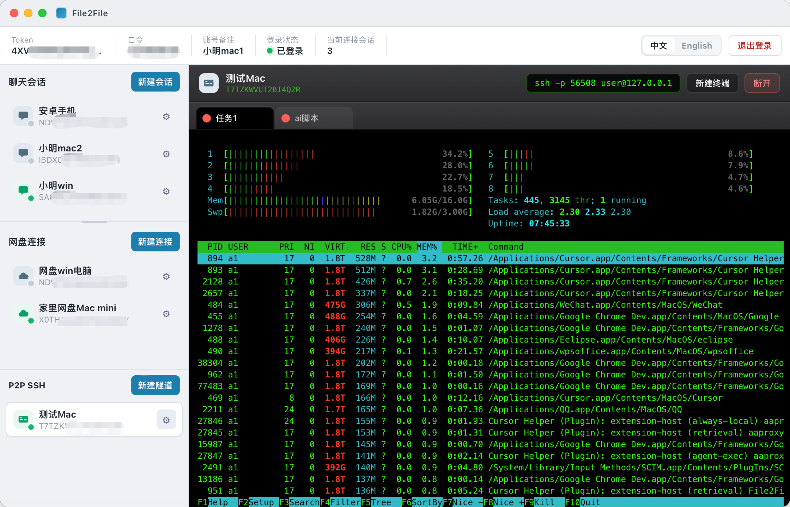

# p2pssh-server

webrpc-based **P2P SSH port-forward server**. It only forwards tunnel traffic to the local SSH daemon (default `127.0.0.1:22`). No auth UI, no terminal.

Use the [File2File](https://github.com/xiaoming-software/File2File-Desktop) desktop app “P2P SSH” feature as the client.



## Requirements

- Go 1.22+
- Local `sshd` (or point `--ssh-port` at your SSH port)
- webrpc token / password / permission

## Build

```bash
chmod +x build.sh
./build.sh
```

Binaries land in `dist/`:

| Platform | Path |
|----------|------|
| macOS arm64 | `dist/darwin-arm64/p2pssh-server` |
| Linux amd64 | `dist/linux-amd64/p2pssh-server` |
| Linux arm64 | `dist/linux-arm64/p2pssh-server` |
| Windows amd64 | `dist/windows-amd64/p2pssh-server.exe` |

The webrpc runtime library is embedded from `sdk/`; no extra shared libraries to ship.

## Publish to GitHub Release

Run `./build.sh` first, then:

```bash
# Edit VERSION at the top of scripts/publish-release.sh, or override:
VERSION=0.1.0 ./scripts/publish-release.sh
# Package only (no upload):
# ./scripts/publish-release.sh --dry-run
```

Requires `gh` installed and logged in (`brew install gh && gh auth login`).

## Run

```bash
./p2pssh-server \
  --token YOUR_TOKEN \
  --passwd YOUR_PASSWD \
  --permission YOUR_PERMISSION
```

| Flag | Default | Meaning |
|------|---------|---------|
| `--ssh-host` | `127.0.0.1` | Local SSH host |
| `--ssh-port` | `22` | Local SSH port |

## Protocol (brief)

- webrpc data magic byte `4` = P2P SSH
- One webrpc session ↔ one client local listen port
- Multiplex concurrent SSH connections via `channel` ids
- Per-channel `seq` for ordered delivery

## License

Same as the repository.
