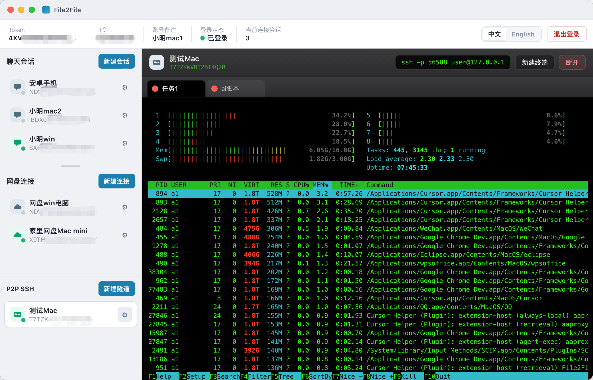

# p2pssh-server

基于 webrpc 的 **P2P 远程终端 / SSH 端口转发** 服务端。

客户端请使用 [File2File](https://github.com/xiaoming-software/File2File-Desktop) 桌面端「P2P SSH」连接。



## 两种通道

| 模式 | 触发 | 作用 |
|------|------|------|
| **shell（推荐）** | 应用内「新建终端」 | 服务端直接开登录 shell 的 PTY，字节经 webrpc 传到 xterm。**不依赖本机 sshd，不依赖客户端系统 ssh** |
| **tcp** | 本机 `ssh -p <本地端口>` | 把 TCP 转到本机 `--ssh-host/--ssh-port`（默认 `127.0.0.1:22`），给外部 SSH 客户端用 |

鉴权只走 webrpc token / 口令；shell 以服务进程用户身份运行。

## 依赖

- Go 1.22+（darwin/linux 的 shell PTY 为纯 Go，可在 macOS 上交叉编译）
- webrpc token / 密码 / 口令
- **tcp 模式**才需要本机 `sshd`；仅用应用内终端时不必开 SSH

## 编译

```bash
chmod +x build.sh
./build.sh
```

全程 `CGO_ENABLED=0`。产物在 `dist/`：

| 平台 | 路径 |
|------|------|
| macOS arm64 | `dist/darwin-arm64/p2pssh-server`（shell PTY） |
| Linux amd64 | `dist/linux-amd64/p2pssh-server`（shell PTY） |
| Linux arm64 | `dist/linux-arm64/p2pssh-server`（shell PTY） |
| Windows amd64 | `dist/windows-amd64/p2pssh-server.exe`（仅 tcp 转发；shell 请用 Linux/macOS） |

webrpc 动态库已从 `sdk/` 嵌入。

## 发布到 GitHub Release

先 `./build.sh`，再：

```bash
# 在 scripts/publish-release.sh 顶部改 VERSION，或临时覆盖
VERSION=0.1.0 ./scripts/publish-release.sh
# 只打包不上传：
# ./scripts/publish-release.sh --dry-run
```

需已安装并登录 `gh`（`brew install gh && gh auth login`）。

## 运行

```bash
./p2pssh-server \
  --token YOUR_TOKEN \
  --passwd YOUR_PASSWD \
  --permission YOUR_PERMISSION
```

| 参数 | 默认 | 说明 |
|------|------|------|
| `--ssh-host` | `127.0.0.1` | tcp 模式转发地址 |
| `--ssh-port` | `22` | tcp 模式转发端口 |

## 协议概要

- webrpc 数据帧 magic 第 4 字节为 `4`
- 一个 webrpc 会话对应客户端一个本地监听端口（tcp 模式）
- `OpOpen` payload：`shell` → PTY；空/`tcp` → 拨号本机 SSH
- `OpResize`：cols/rows 各 u16 LE（仅 shell）
- 会话内 `channel` + `seq` 复用多路

## License

与项目仓库保持一致。
